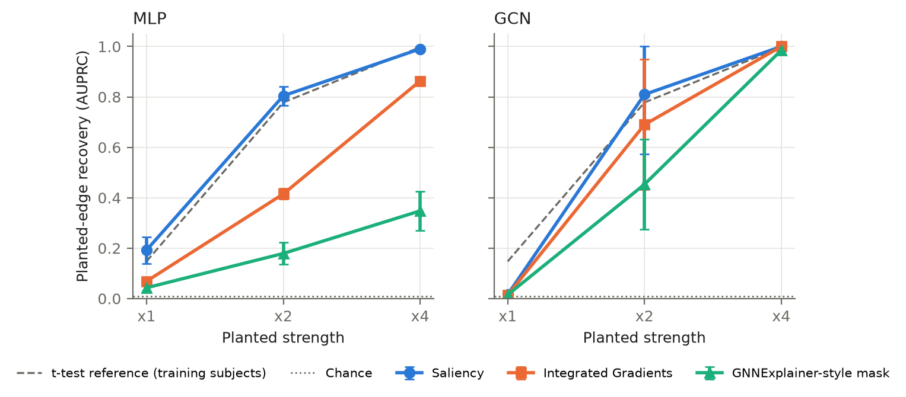
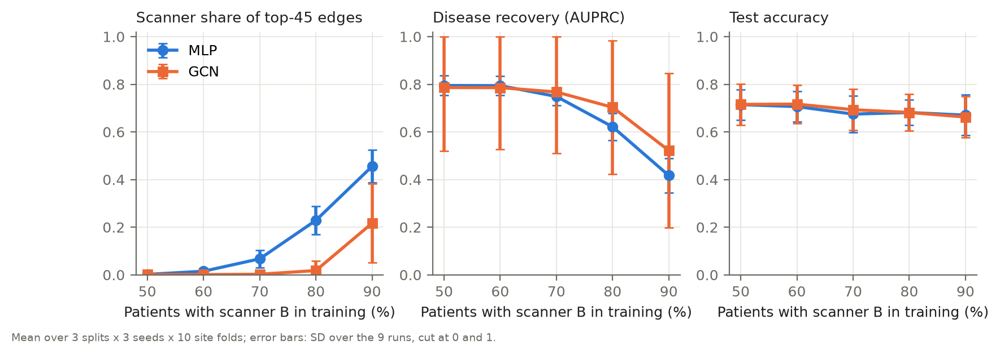
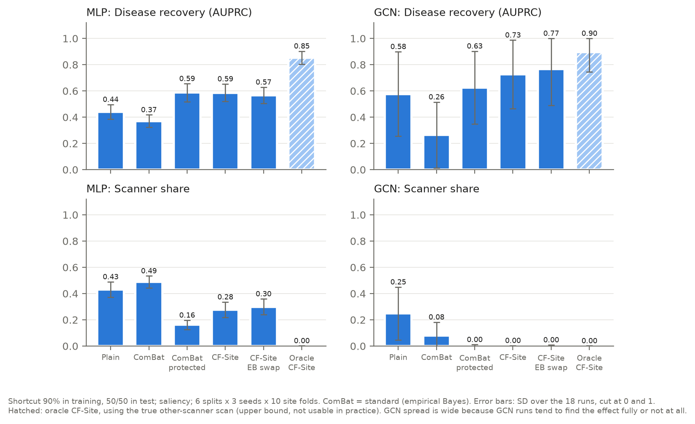
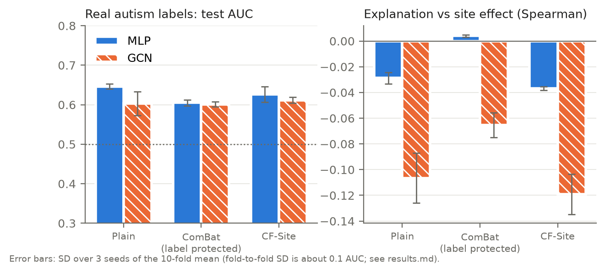

# GNN-in-Medical-Imaging

M.Tech dissertation work on graph neural networks (GNNs) and brain-network models in medical imaging. The main project is **CXB**; earlier explorations are listed at the end.

## CXB: do brain-network explanations find the disease or the scanner?

Brain-network models are often explained by highlighting the connections that drive a prediction, and those explanations are usually validated by matching them to published findings, because real data has no known correct answer. Multi-site scans add a second problem: the hospital or scanner leaves its own fingerprint in the data, and a model can learn that instead of the disease.

CXB (Connectome eXplanation Benchmark) makes the correct answer known:

1. **Planted ground truth.** A known connectivity effect is planted into real healthy-control connectomes from ABIDE, so the "disease" connections are known exactly.
2. **Scanner shortcut.** A scanner effect, sized from real differences between ABIDE hospitals, is linked to the label during training only.
3. **Scoring explanations.** Explanations are scored on whether they point at the planted effect or at the scanner, and fixes are compared: ComBat harmonisation and **counterfactual site training (CF-Site)**, in which each training scan is paired with its counterfactual at another scanner.

## Key findings

**Explainers can find a planted effect.** At twice the typical real autism effect, saliency recovers the planted connections as well as a univariate t-test (AUPRC 0.80–0.81; chance 0.008). With shuffled labels, explainers score at chance, so recovery reflects what the model learned.



**Accuracy hides the scanner shortcut; the explanation shows it.** As the scanner–label link in training grows from 50% to 90%, up to 46% of the top explanation connections move to the scanner regions, while test accuracy falls by only 0.04–0.06. A logistic regression drifts the same way. BrainNetCNN fails differently: its explanation holds, but its accuracy drops.



**The ComBat version decides the outcome.** Under the shortcut, GCN disease recovery ranges from 0.02 to 0.63 across four common ComBat versions. CF-Site clearly beats plain training (+0.15 AUPRC) and matches the best ComBat without harmonising new-site data. With the true other-scanner scan (oracle CF-Site), recovery reaches 0.85–0.90: the limit is the scanner model, not the training method.



**The risk is real on real data.** From the same connectomes, the hospital is predicted with balanced accuracy 0.70 (chance 0.05), against 0.64 for autism (chance 0.50). The connections a scanner affects can be estimated from training data alone, so the scanner share of an explanation can be checked without ground truth.



## Design

| Part | Choice |
| --- | --- |
| Data | ABIDE I (Preprocessed Connectomes Project, CPAC, no global signal regression), AAL-116 atlas, 848 subjects from 19 hospitals |
| Planted effect | One shared signal added to the time series of 10 regions in fake "patients" (×1, ×2, ×4 the real autism effect); connectivity recomputed, so every matrix stays a valid correlation matrix |
| Scanner shortcut | Placed on the 10 regions where real hospitals differ most and sized from real hospital differences; person-specific (main) or a fixed shift per connection (robustness check) |
| Models | Logistic regression, MLP, GCN (BrainGB set-up), BrainNetCNN; BrainGNN and Brain Network Transformer were also reimplemented and reported where they fail a sanity test |
| Explainers | Saliency, Integrated Gradients, GNNExplainer-style input mask |
| Fixes | Four ComBat versions (with or without empirical Bayes and label protection); CF-Site; oracle CF-Site as an upper bound |
| Metrics | Disease AUPRC on the planted connections, scanner share of the explanation, test accuracy |
| Evaluation | Leave-site-out folds (BrainOOD protocol); model selection on validation data only; split-level confidence intervals, paired tests and Holm correction; analysis plans fixed before each experiment |

Full result tables: [CXB/docs/results.md](CXB/docs/results.md). Cohort and quality checks: [CXB/docs/data-summary.md](CXB/docs/data-summary.md).

## Code

```text
CXB/
  src/cxb/      planting.py (planted ground truth), decoy.py (scanner shortcut), combat.py (harmonisation),
                siteswap.py (CF-Site training), models.py, explain.py (explainers and metrics), splits.py
  scripts/      the experiment pipeline, from data download to figures
  tests/        unit tests for planting, decoys, ComBat, CF-Site, models and explainers
  configs/      data settings
  docs/         result tables, data summary and figures
```

Data and experiment outputs are not included in the repository.

## Earlier explorations

| Folder | Topic |
| --- | --- |
| [MLFGNN/](MLFGNN/) | Centre-aware population graph for head-and-neck cancer survival (TCIA); synthetic data only |
| [HNC GNN/](HNC%20GNN/) | Earlier head-and-neck cancer pipeline |
| [AD-PopGraph/](AD-PopGraph/) | Leakage-free population graph for Alzheimer's disease (ADNI); protocol only |
| [Retinal-GNN/](Retinal-GNN/) | Robustness benchmark for graph-based retinal vessel segmentation; metrics only |
| [GNN/](GNN/) | Early topic-search reports |

## Data acknowledgement

ABIDE I via the Preprocessed Connectomes Project. ABIDE's terms require citing Di Martino et al., *Molecular Psychiatry* 19 (2014), and Craddock et al., *Frontiers in Neuroinformatics* (2013).
